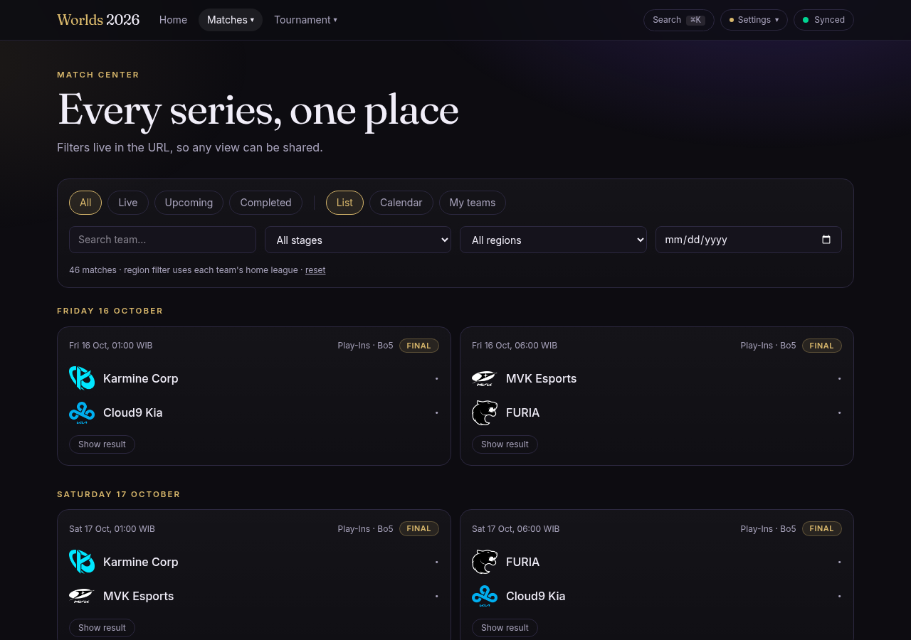
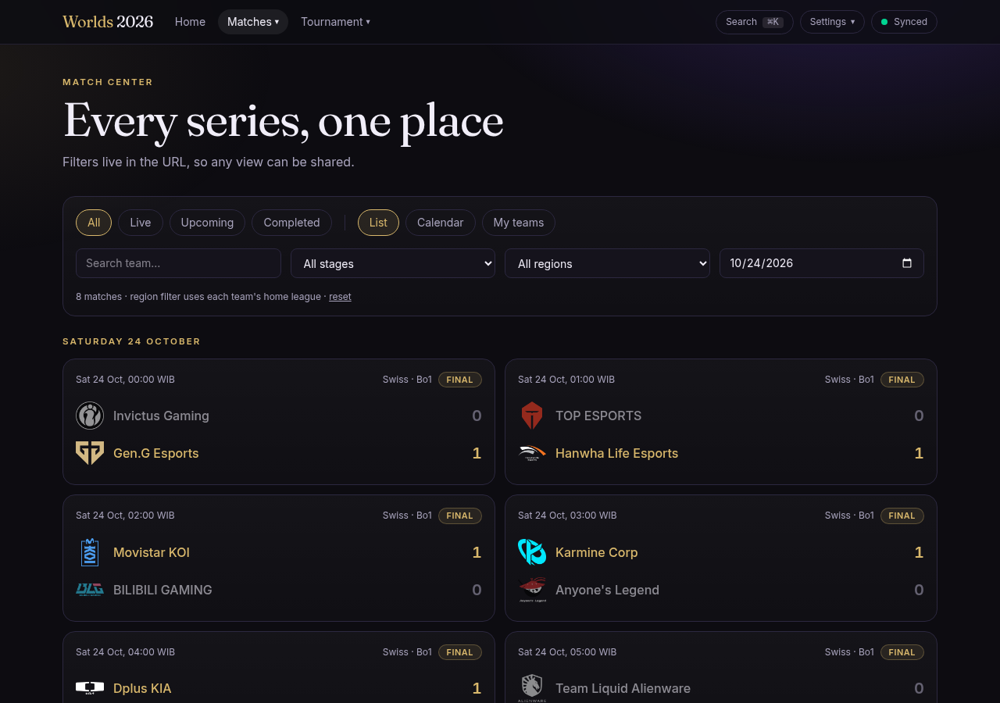
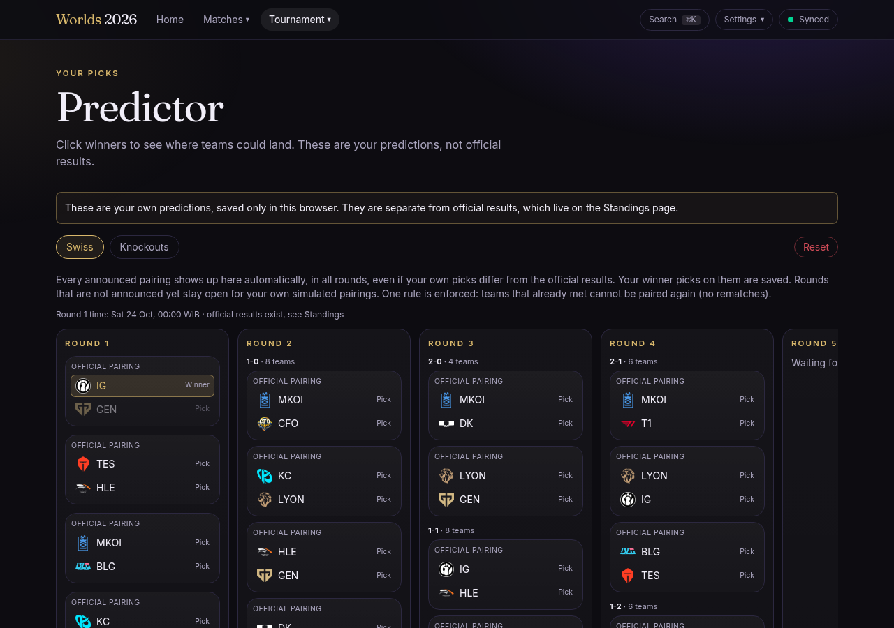

# worlds-2026-qa

Automated end-to-end and API test suite for **Worlds 2026 Live**, a League of Legends Worlds tracker (https://worlds-2026-live.vercel.app). Black-box: it needs no application source and only reads the live site.

**Last run (28 Oct 2026):** 117 test cases, 120 runs across API, desktop Chrome and mobile Chrome. 115 passed, 5 are known defects that still reproduce (written as expected failures, tracked in [docs/BUGS.md](docs/BUGS.md)), 0 unexpected failures, 0 flaky. Full table: [docs/TEST-CASES.md](docs/TEST-CASES.md).

## What it covers

| Area | Examples |
|---|---|
| API contract | health freshness, snapshot schema (zod), ETag and CORS, data invariants (a Bo5 winner has 3 wins), calendar feed validity and no score leaks, security headers, rejected anonymous sync |
| Match center | status, stage, region, date and team filters, URL sharing, empty states, markup typed into search stays inert |
| Spoiler-free mode | hidden scores, per-match reveal, persistence, session-only reveal, detail page, first paint |
| Time zones and languages | every zone and every language, offset arithmetic (Jakarta to Los Angeles = 14 h), bad saved values |
| Swiss predictor | picks, toggling, persistence, reset confirm/dismiss, no network writes, locked knockout slots |
| Standings | Swiss board legality, tab state, zoom limits |
| Accessibility and keyboard | axe-core WCAG 2 A/AA on four pages, skip link, Escape, search palette |
| Resilience | API 500, corrupted storage, unknown routes and ids |

Design notes and risks: [docs/TEST-PLAN.md](docs/TEST-PLAN.md). Defects found: [docs/BUGS.md](docs/BUGS.md).

## Defects found

| ID | What |
|---|---|
| BUG-001 | React hydration error #418 on the home page |
| BUG-002 | `/matches/<unknown id>` returns HTTP 200 instead of 404 |
| BUG-003 | Predictor notice text contrast 4.45:1, AA needs 4.5:1 |
| BUG-004 | Scores flash for a few frames on load with spoiler-free on |
| BUG-005 | An unknown saved time zone sends every page to the error screen |

## Stack

Playwright Test, TypeScript, zod, axe-core, GitHub Actions. HTML, JSON and JUnit reports, traces kept on failure. Chosen for the job: Playwright gives one runner for browser and API tests, parallel runs and traces without extra services.

## Run it

```bash
npm ci
npx playwright install chromium
npx playwright test                 # all projects
npx playwright test --project=api   # API only
npx playwright show-report
npm run summary                     # rewrites docs/TEST-CASES.md from the last run
BASE_URL=http://localhost:3000 npx playwright test   # another deployment
```

Set `CHROME_PATH` to use a system Chrome instead of the bundled Chromium.

## Layout

```
tests/api            API contract and negative cases
tests/e2e            browser cases by feature
tests/support        fixtures, seeded preferences, zod schemas, evidence helper
docs                 test plan, generated case table, bug list
evidence             JSON and JUnit results, screenshots from the last run
.github/workflows    CI (push, PR, every 6 hours, manual)
```

## Screenshots

| Spoiler-free hides scores | Date filter | Swiss predictor |
|---|---|---|
|  |  |  |

Fan project test suite. Not affiliated with Riot Games.
